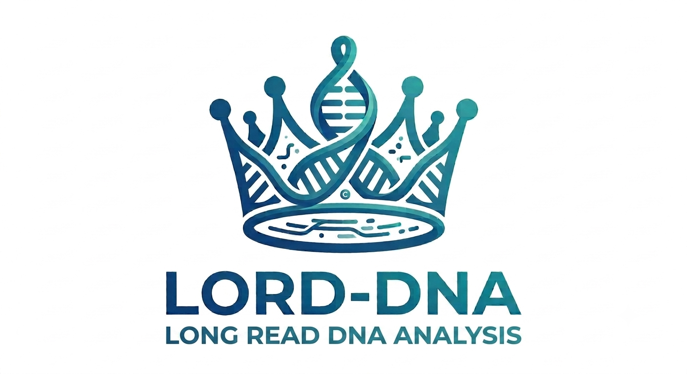

# LORD-DNA
LOng-ReaD DNA Analysis pipeline



------

This pipeline is a toolkit designed to align (minimap2), call and annot SVs (sniffles/cuteSV + AnnotSV) and SNV/indels (clair3/Deepvariant) from nanopore adaptive sampling data.


This pipeline starts with the basecalling step and requires the *.pod5 files. These are the direct outputs of Nanopore sequencing via Minknow.

## Requirements

This pipeline is a **Snakemake workflow**.
Dependencies:
* Snakemake : 7.32.4 or greater.
* Singularity : 3.5.3 or greater.

## Installation


## Configure worflow

To configure this workflow, modify the `./config/config.yaml` file according to your needs.
* `genome`: Fasta file of reference genome.
* `bed`: GTF annotation file of regions to enrich for the adaptive sampling process.
* `indir`: Path of the directory containing the `.fastq.gz` input files.
* `outdir`: Path of the outdirectory.
* `samples`: names of the differents samples.
* `barcode_to_sample`: correspondance between samples and their barcodes.
* `threads`: number of threads to use.
Configuration will be done automatically by the generate_runfolder.py script, using only the samplesheet of the sequencing.

## Run complete workflow

Given that the workflow has been properly configured, it can be executed as follows:
```
cd ./workflow
snakemake --use-singularity --cores
```
Execution will be done automatically by the run_LR.py script, using the config created by generate_runfolder.py.

## Output directory tree


* `alignment folder`: contains subfolders of all aligned and sorted {sample} <.bam> with their corresponding index <.bai>.
* `AnnotSV folder`: contains all <.tsv> of structural variants from sniffles output annotated by greenvaran and then AnnotSV.
* `clair3 folder`: contains subfolders of {sample} with the SNV/indels called by clair3.
* `deepvariant folder`: contains subfolders of {sample} with the SNV/indels called by deepvariant.
* `dorado_demux folder`: contains all <.fastq.gz> of basecalled and demultiplexed files from dorado.
* `greenvaran folder`: contains all <.vcf> of structural variants from sniffles output annotated by greenvaran.
* `greenvaran_snv folder`: contains subfolders of both snv callers, with all <.vcf> of variants from the caller's output annotated by greenvaran.
* `ichorcna folder`: contains subfolders of {sample} with the pdf graphs outputs of ichorcna.
* `multiqc folder`: contains {sample}nanostat.txt files computed with Nanostat, coverage{flowcell}on_off_ratio_target_mqc.json and read_lengths{flowcell}on_off_ratio_target_mqc.json calculated by custum script to have coverage et read lengths of on (enrichment bed) and off (bedtools complement of enrichment bed) target regions. Final report off multiQC is DNASeq_LongRead_Adaptive_Sampling_multiqc_report.html.
* `sniffles folder`: contains all <.vcf> of structural variants called by sniffles.
* `spip folder`: contains subfolders of both snv callers, with all <.csv> of variants from the caller's output annotated by spip.
* `spliceai folder`: contains subfolders of both snv callers, with all <.vcf> of variants from the caller's output annotated by greenvaran, vep, and spliceai.
* `vep folder`: contains subfolders of both snv callers, with all <.vcf> of variants from the caller's output annotated by greenvaran and vep.
filtered_final_snv_clair3.xlsx, filtered_final_snv_deepvariant.xlsx are the final outputs for SNVs.
filtered_final_sv.xlsx is the final output for SVs
